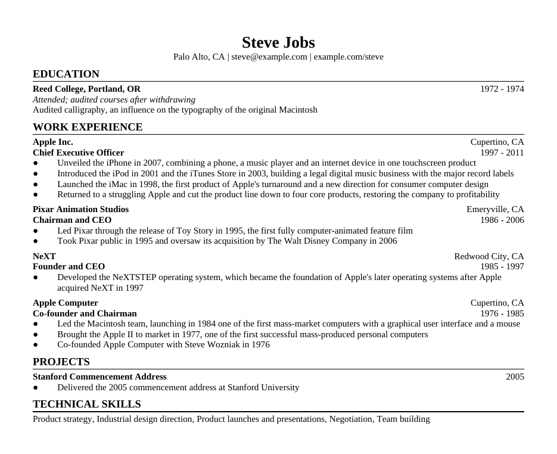

# Mega-Res

**Tailor your resume to every job posting in a minute, without letting AI rewrite a word of it.**

Mega-Res is a [Claude](https://claude.ai) skill plus a small Python tool. You keep one
*mega resume* containing every job, project and bullet point you've ever written. You paste
in a job posting, and Claude picks the bullets that fit it best. Mega-Res then builds a
one-page PDF from your own text, copied exactly, and checks the result before saving it.

<p align="center"></p>

---

## Why

Tailoring a resume for each application works, but it's slow. Asking an AI to do it is fast,
but AI rewrites things. It inflates claims, changes numbers, and drifts away from what you
actually did and can defend in an interview.

Mega-Res splits the work so each side only does what it's good at:

| Step | Done by | Can the wording change? |
|---|---|---|
| Write your mega resume | **You** | You control it |
| Choose bullets for a posting | **Claude**, as a list of bullet **ids** | No: no text is involved |
| Build the PDF | **Mega-Res**, reading your file directly | No: copied verbatim |
| Check the PDF | **Mega-Res**, on every build | Checked against your file |

## What every build guarantees

Before a resume is saved to your `Resume Outputs` folder, Mega-Res verifies that:

- every bullet in the document is identical to a bullet in your mega resume, in the selected order
- every selected bullet, education line and skill can be read back out of the final PDF word for word
- no bullet in the PDF came from anywhere other than your mega resume
- the resume fits the page limit (one page by default)
- anything you marked `priority: must` is included
- your mega resume did not change during the build (its SHA-256 fingerprint is printed every time)

If any check fails, nothing is saved.

The Claude skill also instructs Claude never to edit your mega resume. To be certain it
hasn't been edited, lock it with `chmod a-w mega_resume.yaml` and use `--require-read-only`.

---

## Quick start (Claude app)

1. **Install the skill.** Download this repo, zip the `skill/mega-res` folder, and upload it as a
   skill in Claude's settings.
2. **Make a main folder** for your applications:

   ```
   Applications/
   ├── mega_resume.yaml    ← everything you've done, written once, by you
   └── Resume Outputs/     ← tailored PDFs land here
   ```

   You don't have to create this by hand. In a chat, connect an empty folder and say:
   - *"Import my resume"* and attach your current resume PDF. Mega-Res converts it into
     `mega_resume.yaml` (see [Importing a PDF](#importing-an-existing-resume)).
   - or *"Set up Mega-Res"* to start from an example template.

3. **Tailor.** Connect your main folder, paste a job posting, and say *"tailor my resume."*

Claude will:
- score each of your bullets against the posting
- build drafts and add or remove bullets until the page is full but not over
- save `Resume Outputs/<Your Name>_<Company>_<Role>.pdf`
- tell you what it picked and why, the close calls it left out, and which requirements in
  the posting none of your bullets cover. That last list is useful for a cover letter, or
  for deciding which new bullets to write.

## Quick start (Claude Code)

```bash
git clone https://github.com/<you>/mega-res.git
cp -r mega-res/skill/mega-res ~/.claude/skills/mega-res
pip install -r mega-res/skill/mega-res/requirements.txt
```

Install LibreOffice and poppler, which are used to make and read PDFs:

```bash
# macOS
brew install --cask libreoffice && brew install poppler
# Debian / Ubuntu
sudo apt install libreoffice-writer poppler-utils
```

Then run `claude` from your main folder and paste a job posting.

## Using the tool directly (no Claude)

Everything Claude does runs through a command-line tool you can use yourself. Set
`PYTHONPATH=skill/mega-res` and run:

```bash
# set up a main folder with an example mega resume
python3 -m megares init ~/Applications

# or create it from your current resume PDF
python3 -m megares import my_resume.pdf ~/Applications

# validate your mega resume and print its fingerprint
python3 -m megares check ~/Applications/mega_resume.yaml

# build a resume from a selection file you wrote
python3 -m megares build ~/Applications/mega_resume.yaml selection.yaml \
    --company "Acme" --role "Data Scientist" \
    --outdir ~/Applications/"Resume Outputs"
```

Use `--preview draft.pdf` in place of `--outdir` to build a draft without saving it.

---

## The mega resume format

A YAML file. Every bullet gets a unique `id`; the text is used exactly as written.

```yaml
header:
  name: Steve Jobs
  contact:
    - {text: "steve@example.com", url: "mailto:steve@example.com"}

education:
  - id: reed
    school: Reed College, Portland, OR
    dates: 1972 - 1974
    degree: Attended; audited courses after withdrawing
    lines:
      - {id: reed-calligraphy, text: "Audited calligraphy, an influence on the typography of the original Macintosh"}

experience:
  - id: apple-ceo
    org: Apple Inc.
    location: Cupertino, CA
    title: Chief Executive Officer
    dates: 1997 - 2011
    priority: must                     # always include this job
    bullets:
      - id: apple-iphone
        tags: [product, mobile]        # optional hints for selection
        text: "Unveiled the iPhone in 2007, combining a phone, a music player and an internet device in one touchscreen product"

projects:
  - id: stanford
    name: Stanford Commencement Address
    dates: "2005"                      # quote bare years
    bullets:
      - id: stanford-speech
        text: "Delivered the 2005 commencement address at Stanford University"

skills:
  - "Product strategy"
  - "Industrial design direction"
```

The example data is Steve Jobs' public career history, used for illustration, with placeholder
contact details. The full example is at
[`skill/mega-res/templates/mega_resume.example.yaml`](skill/mega-res/templates/mega_resume.example.yaml).

**Tips**
- **Put everything in.** The page limit is applied per resume, not to the mega resume, so
  include roles, projects and bullets you'd never fit on one page.
- **Write alternatives.** For an important accomplishment, write 2-3 versions that emphasize
  different things (e.g. the business result vs. the technical method). Choosing between
  them gives you tailoring without rewording.
- **Tags are hints, not rules.** Claude judges relevance from the text itself; tags help
  break ties.

### Styling

An optional `style:` block at the top of the mega resume controls the look:

```yaml
style:
  font: Times New Roman      # any installed font
  body_size: 10
  name_size: 18
  section_size: 12
  margin_lr_in: 0.5
  margin_tb_in: 0.5
  bullet_char: "●"
  page_limit: 1
  skills_layout: inline      # "inline" (one line) or "lines" (one "Category: ..." per line)
```

The layout is a classic single-column resume: centered name, ruled section headings,
right-aligned dates. PDFs are rendered with LibreOffice. Where Times New Roman isn't
installed, the metric-compatible Liberation Serif is used, so line breaks don't change.

---

## Importing an existing resume

`megares import` converts a resume PDF into `mega_resume.yaml`. **It uses no AI.** It reads
each word's font, size and position and applies fixed rules.

It writes the file only if:
- every bullet, education line and skill it found appears word for word in your PDF, **and**
- every line of the PDF was used.

Otherwise it writes nothing and lists the lines it couldn't place. It never overwrites an
existing `mega_resume.yaml`.

The text is guaranteed to be verbatim. The *structure* is a rule-based judgment (e.g. which
line is the job title and which is the organization), so the import prints one summary line
per job for you to check.

### Works with

Standard single-column resumes exported from Word, Google Docs, Pages, LaTeX or LibreOffice:
- name at the top in the largest font; contact details below, separated by `|`, `•` or `·`
- section headings in ALL CAPS: `EDUCATION`, `EXPERIENCE`, `WORK EXPERIENCE`,
  `PROFESSIONAL EXPERIENCE`, `RESEARCH EXPERIENCE`, `PROJECTS`, `SKILLS`, `TECHNICAL SKILLS`, ...
- each job as one or two heading lines (organization and title, in either order), with
  location and dates at the right margin
- bullets starting with a bullet character (`●`, `•`, `▪`, `◦`, `-`, `–`, `*`, ...), with
  wrapped lines indented under them
- skills as one comma-separated list, or one `Category: a, b, c` line per category

### Fails with

| Resume feature | What happens |
|---|---|
| Scanned or image-only PDF | Fails: "no text found". Export a text PDF from the original, or run OCR first. |
| Two-column or sidebar layout | Fails the verbatim check because the columns' lines interleave. Use a single-column version. |
| Text in tables or text boxes | Usually fails the same way as two columns. |
| Headings not in ALL CAPS (e.g. "Experience") | Not recognized as headings; fails with unused lines. |
| Other sections (Summary, Awards, Publications, ...) | Skipped and reported. Nothing is written unless you pass `--allow-unused`; add them by hand. |
| A title with no common title word (e.g. "Quant") listed *above* the organization | Organization and title come out swapped. Swap them back in the file. |
| Dates on their own line instead of at the right margin | Imported as the title or as an extra line. Fix by hand. |
| Bullets with no bullet character | Treated as headings and become separate entries. |
| Skill categories without `Category:` labels | Merged into one comma-separated list. |

---

## Limitations

- **Claude's explanation isn't verified.** Its reasons for choosing bullets, and the list of
  requirements you don't cover, are model output.
- **Selection quality depends on your bullets.** Mega-Res can only choose from what you've
  written. If a posting needs something your mega resume doesn't say, the report tells you.
- **One layout.** There's a single built-in resume design, adjustable through `style:`.
  Multi-column designs aren't supported.
- **Anything that can write to your mega resume can change it.** Locking the file and
  checking the fingerprint printed on each build is how you'd notice.

## Repository layout

```
mega-res/
├── skill/mega-res/              ← the skill: upload or copy this folder
│   ├── SKILL.md                 ← instructions Claude follows
│   ├── megares/                 ← the Python tool
│   │   ├── cli.py               ← init / import / check / build commands
│   │   ├── master.py            ← loading and validating the mega resume
│   │   ├── render.py            ← .docx and PDF rendering
│   │   ├── verify.py            ← verbatim checks on every build
│   │   └── importer.py          ← rule-based PDF → YAML import
│   ├── templates/               ← example mega resume and selection file
│   └── requirements.txt
├── tests/
└── docs/
```

## Development

```bash
pip install -r skill/mega-res/requirements.txt pytest
python3 -m pytest tests
```

The tests that build or read PDFs are skipped if LibreOffice isn't installed.

Contributions are welcome. The most useful are new import rules for common resume layouts,
each with a test and a row in the [works with / fails with](#importing-an-existing-resume)
tables.

## License

[MIT](LICENSE)
